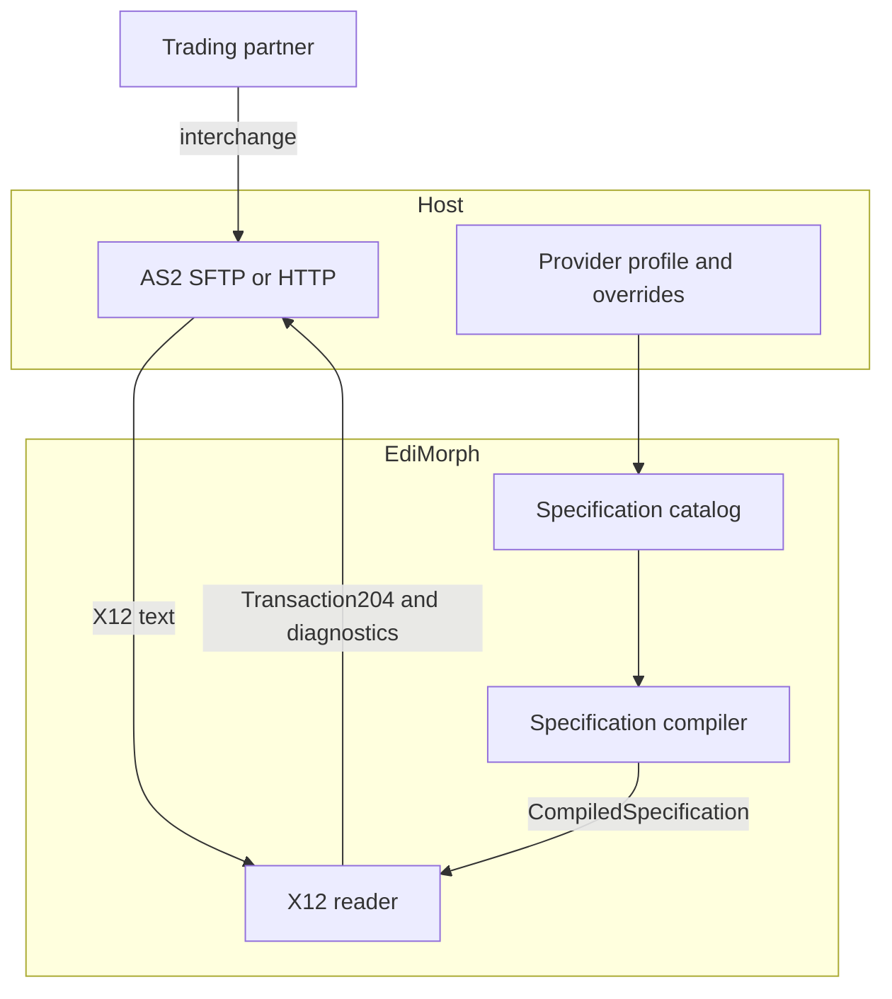
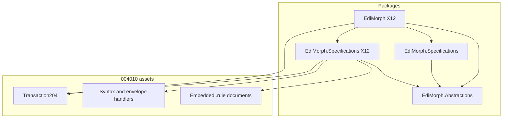
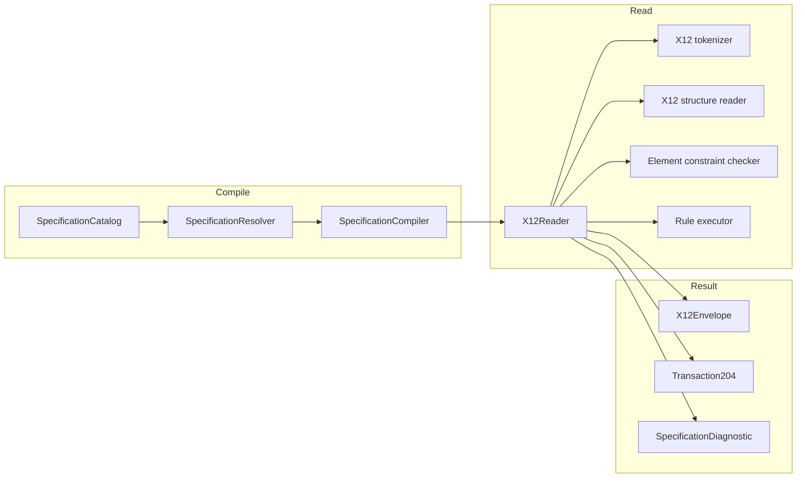
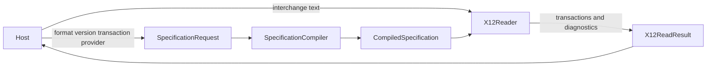
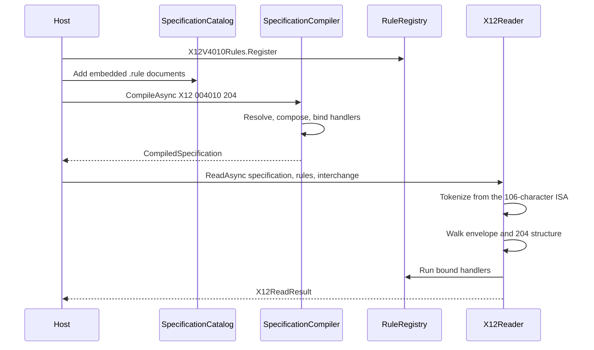
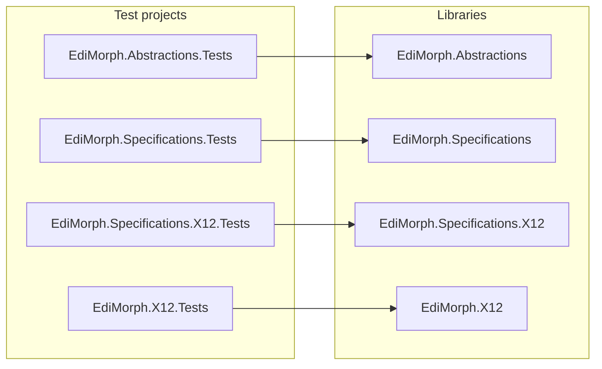
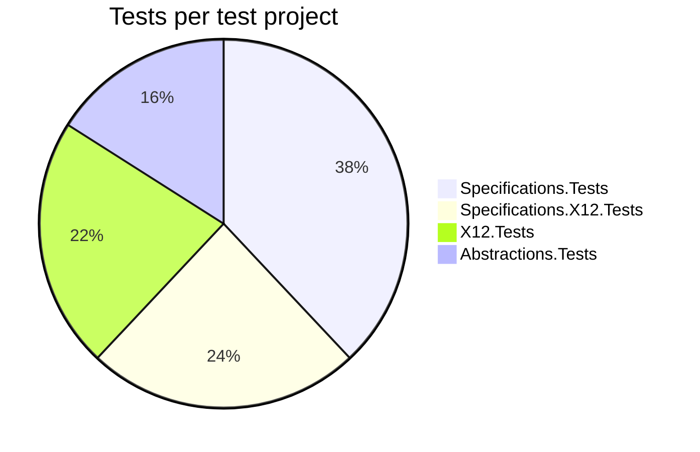

# EdiMorph - Architecture & Design Documentation

> A standards-first .NET library for EDI. Each format, version, and transaction is implemented once. A provider adds a profile, override rules, and C# handlers for the differences in its implementation guide.

This document describes the pipeline, the decisions behind it, and how to read an X12 004010 transaction 204. Version **0.1.1** is that reader. **1.0.0** waits until the main transactions for a full provider integration are in place.

---

## Table of Contents

- [Features](#features)
- [High-level diagram](#high-level-diagram)
- [Entire architecture diagram](#entire-architecture-diagram)
- [Components diagram](#components-diagram)
- [Request diagram](#request-diagram)
- [Sequence diagram](#sequence-diagram)
- [Package overview](#package-overview)
- [Applied design principles and patterns](#applied-design-principles-and-patterns)
- [Architectural decisions](#architectural-decisions)
- [Best practices applied](#best-practices-applied)
- [Technologies used](#technologies-used)
- [Project structure](#project-structure)
- [Getting started](#getting-started)
- [Testing](#testing)
- [Failure model](#failure-model)
- [Read a 204](#read-a-204)
- [AI usage](#ai-usage)

---

## Features

- **One specification per format, version, and transaction** - X12 004010 204 and a future 005010 204 are different specifications. Versions do not inherit segment dictionaries.
- **Typed transaction, not a canonical model** - the reader returns `Transaction204`. A provider overlay changes constraints and diagnostics. It does not change the CLR type.
- **Local constraints in JSON, cross-field rules in C#** - `.rule` files hold identity, layout, element types, lengths, usage, code lists, and handler ids. Comparisons, conditionals, counts, and envelope integrity are C# classes.
- **Provider profiles tighten the standard** - a profile may restrict codes, lengths, usage, and occurrences. Loosening a standard rule requires an explicit partner-dialect profile that cites the parent rule.
- **Stable diagnostics** - a bad interchange returns `X12ReadResult` with `EDI1xxx` codes. The reader does not throw for EDI that fails validation.

Transport such as AS2, SFTP, and HTTP stays in the host. EdiMorph starts at the interchange text.

---

## High-level diagram

The host owns the connection. EdiMorph compiles a specification, reads one interchange, and returns the typed transaction plus diagnostics.



---

## Entire architecture diagram

Dependency rule: `EdiMorph.Specifications` does not reference X12. The X12 package references the shared compiler and the X12 assets. Provider guides stay outside this repository.



---

## Components diagram



---

## Request diagram

A read has two steps. Compile selects the standard, and optionally a provider profile. Read walks one interchange against that compiled specification.



Precedence inside the compiler is format syntax, then the version dictionary and envelope, then the transaction structure, then the provider profile.

---

## Sequence diagram

### Compile, then read a 204



The base specification is cached. A provider overlay is cached separately and shares the segments it does not change. A failed compilation is not cached.

---

## Package overview

Install the reader. NuGet restores the other three at the same version.

| Package | Responsibility |
| --- | --- |
| `EdiMorph.Abstractions` | `SpecificationRequest`, diagnostics, rule scope, and the handler contract |
| `EdiMorph.Specifications` | Catalog, resolver, tightening-only composer, compiler, and the compiled specification |
| `EdiMorph.Specifications.X12` | Embedded 004010 `.rule` documents, syntax handlers, and `Transaction204` |
| `EdiMorph.X12` | Tokenizer, structure walk, element checks, and `X12Reader` |

`X12ReadResult.Transactions` is the 204 list. A later transaction is added as its own member. Replacing `Transactions` is a 2.0.0 change.

---

## Applied design principles and patterns

1. **Immutable compiled specification** - authoring documents are parsed once into a `CompiledSpecification`. The reader does not re-read JSON while it walks an interchange.
2. **Strategy** - each segment with X12 syntax notes has one handler class. Envelope integrity and 204 stop syntax are their own handlers. The compiler binds handler ids from `customRules`.
3. **Explicit extension** - a provider profile is selected by name and revision. The standard specification stays intact for every other caller.
4. **Adapter** - `X12Reader` is the X12 adapter over the shared compiler. Another format would be another reader, not a branch inside this one.
5. **Two-level cache** - the base standard is compiled once. Each provider overlay is compiled on top of that base.
6. **Diagnostics for EDI failures, exceptions for programmer errors** - null arguments and a specification that is not X12 throw. A bad interchange returns diagnostics.
7. **Dependency direction** - Abstractions has no JSON and no X12 types. Specifications does not reference X12.

---

## Architectural decisions

| Decision | Rationale |
| --- | --- |
| **No canonical shipment, invoice, or load model** | Providers share the standard transaction type. Portal mapping stays in the host. |
| **JSON for local constraints only** | Length, usage, code lists, and occurrence grammar are data. Cross-field comparisons in JSON were rejected. |
| **C# for relational syntax** | X12 P, R, C, E, and L notes, envelope control numbers, and 204 stop order are code. |
| **Standard subset by default** | A profile may tighten a rule. Widening usage, codes, or occurrences requires `partner-dialect` and `departsFrom`. |
| **One class per segment syntax, one class per provider guide** | Standard handlers are reusable. A provider guide class lives with that provider, outside this package. |
| **004010 and 005010 do not share a dictionary** | The reuse key is format + version + transaction. |
| **Inbound reader first** | The host generates outbound EDI. This library validates and reads what arrived. |
| **Shared package version** | All four packages ship as one product. `0.2.0` adds a transaction. `0.1.x` stays compatible for the 204 surface. |
| **Public package has no partner guide** | Partner profiles, samples, and implementation guides are not embedded here. |

---

## Best practices applied

- **Single responsibility** - the catalog loads documents, the resolver selects them, the compiler composes them, and the reader executes them.
- **Open for a new transaction** - a new transaction adds rule documents, a typed model, and a handler. It does not rewrite the tokenizer.
- **Design by contract** - `SpecificationRequest` rejects a blank format or version. `X12Reader` rejects a failed specification.
- **Stable diagnostic codes** - callers match `EDI1001` through `EDI1204` instead of message text.
- **Unit tests per package** - each library has a test project. Tests follow a fixed naming and assertion style.
- **Package version equals the product version** - `Directory.Build.props` sets one version for every project.

---

## Technologies used

### Runtime and language

| Technology | Version |
| --- | --- |
| **.NET** | **10.0** (`net10.0` across all projects) |
| **C#** | **14** (default language version for the .NET 10 SDK) |

### Published packages

| Package | Version |
| --- | --- |
| `EdiMorph.Abstractions` | 0.1.1 |
| `EdiMorph.Specifications` | 0.1.1 |
| `EdiMorph.Specifications.X12` | 0.1.1 |
| `EdiMorph.X12` | 0.1.1 |

Feed: [nuget.org/packages/EdiMorph.X12](https://www.nuget.org/packages/EdiMorph.X12).

### Test NuGet packages

| Package | Version | Used in |
| --- | --- | --- |
| `FluentAssertions` | 7.2.0 | All test projects |
| `Microsoft.NET.Test.Sdk` | 17.14.1 | All test projects |
| `xunit` | 2.9.3 | All test projects |
| `xunit.runner.visualstudio` | 3.1.4 | All test projects |

The library projects have no third-party runtime dependencies.

---

## Project structure

```text
EdiMorph/
├── src/
│   ├── EdiMorph.Abstractions/             # Request, diagnostics, handler contract
│   ├── EdiMorph.Specifications/           # Catalog, resolver, compiler
│   ├── EdiMorph.Specifications.X12/       # 004010 rules, handlers, Transaction204
│   │   └── V4010/
│   │       ├── Common/                    # Syntax, envelope, segment rules
│   │       └── Transactions/204/          # Typed 204
│   └── EdiMorph.X12/                      # Reader
├── tests/
│   ├── EdiMorph.Abstractions.Tests/
│   ├── EdiMorph.Specifications.Tests/
│   ├── EdiMorph.Specifications.X12.Tests/
│   └── EdiMorph.X12.Tests/
├── Directory.Build.props                  # Shared package version and README
├── EdiMorph.slnx
└── README.md
```

---

## Getting started

Prerequisites: the .NET 10 SDK.

Install the reader:

```xml
<PackageReference Include="EdiMorph.X12" Version="0.1.1" />
```

From this repository:

```bash
dotnet test EdiMorph.slnx
dotnet pack EdiMorph.slnx -c Release -o artifacts
```

`dotnet pack` produces the four packages. Test projects set `IsPackable` to false.

The read path is in [Read a 204](#read-a-204).

---

## Testing

Tests are unit tests. There is no container and no integration host. The standard they follow is [Unit testing standards](https://github.com/TuralSuleymani/Rovio.Matchmaking/blob/master/docs/prompts/coding_standards/unit-testing-standards.md).

### How to run tests

From the repo root:

```bash
dotnet test EdiMorph.slnx

dotnet test tests/EdiMorph.Abstractions.Tests
dotnet test tests/EdiMorph.Specifications.Tests
dotnet test tests/EdiMorph.Specifications.X12.Tests
dotnet test tests/EdiMorph.X12.Tests
```

Filter example: `dotnet test --filter FullyQualifiedName~X12ReaderTests`.

### Test project to library



### Test counts

| Test project | Focus | Tests |
| --- | --- | ---: |
| `EdiMorph.Abstractions.Tests` | Request, registry, handler contract | 8 |
| `EdiMorph.Specifications.Tests` | Compile, overlay, authoring, resolution | 19 |
| `EdiMorph.Specifications.X12.Tests` | Envelope, ISA, segment syntax, 204 syntax | 12 |
| `EdiMorph.X12.Tests` | Reader success and failure paths | 11 |
| **Total** | | **50** |



---

## Failure model

| Scenario | Behavior |
| --- | --- |
| ISA header is short, or delimiters are not distinct | `EDI1201`. No envelope and no transactions |
| A mandatory segment is missing, or a segment is outside the structure | `EDI1202`. An unknown segment is also kept as an extension |
| Usage, length, or allowed values fail | `EDI1203` |
| A relational syntax note fails | `EDI1101` |
| Envelope control numbers or counts disagree | `EDI1102` |
| 204 stop sequence or stop weight disagrees | `EDI1103` |
| A provider profile loosens the standard without a dialect citation | `EDI1004`. Compilation fails |
| A `.rule` file contains a relational operator | `EDI1011`. Compilation fails |
| A handler id is not registered | `EDI1006`. Compilation fails |
| The caller passes null, or a specification that is not a successful X12 transaction | `ArgumentException` |

`X12ReadResult.IsSuccess` is false when any diagnostic has error severity. Callers branch on the code.

| Range | Owner |
| --- | --- |
| `EDI1001`–`EDI1011` | Compiler and authoring |
| `EDI1101`–`EDI1103` | Standard handlers |
| `EDI1201`–`EDI1204` | Reader |

---

## Read a 204

```csharp
using EdiMorph;
using EdiMorph.Rules;
using EdiMorph.Specifications;
using EdiMorph.Specifications.X12;
using EdiMorph.Specifications.X12.V4010;
using EdiMorph.X12;

var rules = new RuleRegistry();
X12V4010Rules.Register(rules);

var documents = X12RuleDocuments.ReadAll()
    .Select(document => new SpecificationText(document.Path, document.Content));
var catalog = new SpecificationCatalog();
catalog.Add(new InMemorySpecificationSource(documents));

var compiler = new SpecificationCompiler(catalog, rules);
var specification = await compiler.CompileAsync(
    new SpecificationRequest("X12", "004010", "204"));

var result = await new X12Reader().ReadAsync(specification, rules, interchange);
if (result.IsSuccess)
{
    var carrier = result.Transactions[0].Beginning?.Elements["02"];
}
```

`result.Transactions` contains each 204. `result.Diagnostics` lists every standard failure. A provider profile is a `SpecificationRequest` with a provider name and profile revision, plus that profile's `.rule` files added to the same catalog. Those files are not part of this package.

`Transaction204` keeps X12 segments. `Beginning` is B2, `Stops` is loop 0300, and a segment the 204 structure does not name is an extension on the node where it appeared.

---

## AI usage

The architecture decisions in this library are mine: one specification per format, version, and transaction; JSON for local constraints; C# for cross-field rules; no canonical business model.

I used AI to help generate:

- the implementation of the compiler, handlers, and reader
- the unit tests, following [my unit testing standards](https://github.com/TuralSuleymani/Rovio.Matchmaking/blob/master/docs/prompts/coding_standards/unit-testing-standards.md)
- the Mermaid diagrams and this README

The overall system design remains mine.
